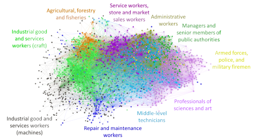

**Skill and spatial mismatches for sustainable development in Brazil**. We combine a regional occupational mobility network with an agent-based labour market model to study development scenarios for Brazil. We find that the pathways delivering the largest deforestation and emission reductions disproportionately benefit high-skill workers while increasing unemployment among agricultural and other low-skill workers, who are less occupationally and geographically mobile — a gap that well-targeted labour market mobility policies can help close. [Read more](https://www.nature.com/articles/s41893-026-01939-z)

{fig-alt="Chart of occupational mismatch scenarios for Brazil"}
