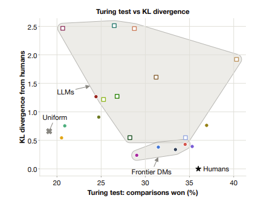

**Decision Models as Scalable Economic Surrogates that Capture Human Variation.** We introduce Decision Models (DMs) — AI tools that return a probability distribution over a fixed set of options rather than free text — as an alternative to LLMs for simulating human economic behaviour. Testing 10 DMs against 8 LLMs on household consumption surveys, classic economic games, and labour market experiments, leading DMs better reproduce the diversity of human responses than LLMs across all three settings, while running about 10x faster and over 100x cheaper; they perform relatively less well on economic games than on survey data. [Read more](https://arxiv.org/abs/2611.05553)

{fig-alt="Scatter plot comparing Turing test comparisons-won percentage against KL divergence from humans for decision models, LLMs, and a uniform baseline"}
